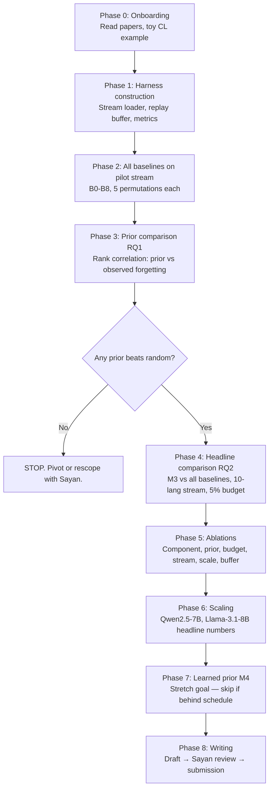

# Asymmetric Interference-Aware Replay for Language-Incremental Continual Learning

**Project type:** MTech research project (NLP × continual learning)
**Supervisor:** Sayan
**Target venues:** ACL / EMNLP 2026 (primary), ICLR 2026 (stretch)
**Realistic duration:** 6–8 months of focused work

---

## 0. How to read this document

This is a self-contained research plan. Read it in order the first time. After that, sections 5 (execution plan) and 11 (ablations) are the ones you will return to weekly. Sections 1–4 explain *why* we are doing this; sections 5 onwards explain *what* and *how*.

If you do not understand a term in this document, do **not** keep reading — stop, look it up, ask. Misunderstood foundations compound into wasted months.

---

## 1. The big picture

Large multilingual language models forget. When you take a model that speaks English well and fine-tune it on Hindi, the English ability degrades. When you then fine-tune it on Bengali, both English and Hindi degrade further. This is **catastrophic forgetting**, and it is the central obstacle to *language-incremental learning* — the realistic setting where new languages must be added to a deployed model over time without retraining from scratch.

The dominant defense against forgetting is **experience replay**: keep a small buffer of examples from past languages, and rehearse them while training on the new language. The question this project asks is:

> **Given a fixed replay budget, how should we distribute it across past languages to minimize total forgetting?**

Existing replay methods either (a) sample past examples uniformly, (b) sample by embedding similarity, or (c) sample by gradient-based criteria (e.g., gradient coreset). None of these methods uses the fact that we already know a great deal about *how languages relate to each other* — through typology, script, family, and direct interference measurements.

Our claim is that a **directional, script-aware interference prior** gives a better replay distribution than any of the existing approaches, and that the gain is largest in the realistic small-budget regime.

---

## 2. The hypothesis

### 2.1 Naive form (which we will *not* use)

> *When adding language L_{n+1}, replay weights over past languages {L_1, ..., L_n} should be proportional to typological distance — distant languages need more rehearsal to be preserved.*

This naive form sounds plausible but is **probably wrong** based on recent evidence. See §2.3.

### 2.2 Refined form (this is the actual hypothesis we test)

> *Replay weights for language-incremental CL should be proportional to a directional, script-aware cross-lingual interference score from each past language to the incoming language — not to symmetric typological distance.*

### 2.3 Why the refinement matters

A Meta paper (Alastruey et al., August 2025, arXiv:2508.02256) trained encoder-only transformers on all pairs of 83 languages and constructed an *Interference Matrix*. Three findings from that paper drive our refinement:

1. **Interference is asymmetric.** Welsh is a low-interference donor (adding Welsh data does not hurt other languages much) but a high-interference recipient (Welsh forgets quickly when other languages are added). Symmetric typological distance cannot capture this.
2. **Script matters more than family.** Same-script languages interfere less, regardless of family.
3. **Standard linguistic taxonomies are weak predictors.** Family alone, and embedding similarity alone, do not align well with measured interference.

This is the empirical foundation for the refined hypothesis.

### 2.4 The true novelty (state this carefully — reviewers will hunt for prior art)

What we are doing that nobody has done before:

- **Replay scheduling literature** (GCR, DER++, function-vector training) is modality-agnostic — it does not use linguistic structure.
- **Multilingual CL literature** (M'hamdi et al. ACL 2023, Winata et al. 2023 / LR-ADJUST) studies *what* forgetting looks like across many languages but uses generic CL methods underneath.
- **Typology-aware NLP** (LangRank, TIPA, X-ELM) uses linguistic structure for *source-language selection*, *parameter aggregation*, and *expert clustering* — but never for replay weighting.
- **COMPASS** (Flynn 2026, our closest competitor) does adaptive sampling for continual multilingual PEFT but is *task-distribution-driven*, not linguistically-informed. The authors explicitly leave linguistic structure as an open problem.

The white space we occupy: **a linguistically-informed, asymmetric, script-aware replay scheduler for language-incremental continual learning, with a theoretical justification linking the prior to gradient coreset selection.**

### 2.5 Sub-hypotheses (testable)

- **H1 (Predictive power):** Asymmetric interference scores predict per-language forgetting in language-incremental CL better than symmetric typological distance, embedding similarity, or random.
- **H2 (Replay gain):** A replay scheduler weighted by the H1-winning prior outperforms uniform replay, DER++, GCR, embedding-similarity replay, and COMPASS on standard multilingual CL metrics.
- **H3 (Budget regime):** The gain from H2 is largest at small replay budgets (1–5%) and shrinks as budget grows toward 25%+.
- **H4 (Learnability — stretch):** A prior learned online from validation-loss trajectories recovers script asymmetry without being explicitly told about scripts.

---

## 3. Background concepts you must internalize

You should be able to explain each of the following to me on a whiteboard in under 5 minutes before you start coding.

### 3.1 Catastrophic forgetting and the stability–plasticity dilemma

A neural network's weights store everything it has learned. Gradient updates for a new task *move* those weights, which can erase the configuration that supported earlier tasks. Stability = preserving old knowledge. Plasticity = absorbing new knowledge. Continual learning is the search for the right trade-off.

### 3.2 The three families of CL methods

- **Regularization-based** (EWC, Synaptic Intelligence, MAS): add a penalty term that resists movement of important parameters.
- **Architectural/parameter-isolation** (Progressive Nets, PackNet, MAD-X adapters): assign separate capacity to each task.
- **Replay-based** (ER, DER++, GCR): store a small subset of past data and rehearse it alongside new data. **This is the family we work in.**

### 3.3 Multilingual model basics

- A multilingual LLM shares parameters across languages. Sharing enables transfer between similar languages but causes interference between dissimilar ones — the "curse of multilinguality."
- Language identity is encoded both in input (tokens) and implicitly in activations (some "language-specific neurons" emerge during training).
- Adding a new language typically requires either vocabulary expansion or careful tokenization; this project mostly avoids vocab expansion to isolate the replay effect.

### 3.4 Typology, lang2vec, URIEL+

Linguistic typology characterizes languages by structural features: word order (SVO vs SOV), morphological complexity, phonological inventory, etc. **lang2vec** (Littell et al., 2017) provides binary feature vectors per language, sourced primarily from WALS. **URIEL** is the underlying database; **URIEL+** (2025) is the updated version. **Grambank** is a more complete syntactic-feature database that addresses WALS's missing-data problem.

For our purposes, lang2vec gives us symmetric distances between any two languages along multiple modalities (syntactic, phonological, geographic, genetic).

### 3.5 The Interference Matrix

Alastruey et al. (2025) define the interference matrix entry *M*(*B*, *A*) = (*L*_{A,B} − *L*_A) / *L*_A, where *L*_A is the loss of a model trained only on language A, and *L*_{A,B} is the loss on A of a model trained on both A and B. Positive *M*(*B*, *A*) = adding B hurts A. The matrix is **asymmetric**: *M*(*B*, *A*) ≠ *M*(*A*, *B*).

This is the prior we want to use for replay weighting.

### 3.6 Parameter-efficient fine-tuning (PEFT) and LoRA

LoRA injects low-rank trainable matrices into a frozen backbone. We use LoRA for two reasons: (1) it makes language-incremental experiments tractable on a small compute budget, and (2) it matches COMPASS's experimental setup so comparisons are fair.

---

## 4. Research questions

| RQ  | Question                                                                                                                                                                                                                                     | Why it matters                                                                                                                                  |
| --- | -------------------------------------------------------------------------------------------------------------------------------------------------------------------------------------------------------------------------------------------- | ----------------------------------------------------------------------------------------------------------------------------------------------- |
| RQ1 | Which language-similarity prior best predicts per-language forgetting on a multilingual stream? Candidates: URIEL+ syntactic, Grambank syntactic, script-overlap, family-only, asymmetric interference matrix, embedding similarity, random. | Establishes the empirical basis for the choice of prior. If no prior beats random, the project fails fast (good — fail in week 6, not month 6). |
| RQ2 | Does a replay scheduler weighted by the RQ1-winning prior outperform uniform replay, DER++, GCR, embedding-similarity replay, and COMPASS on standard multilingual CL benchmarks?                                                            | This is the headline claim of the paper.                                                                                                        |
| RQ3 | How does the gain in RQ2 scale with replay budget?                                                                                                                                                                                           | Tells reviewers and practitioners *when* our method matters. The hypothesized U-curve (gain peaks at small budgets) is itself a contribution.   |
| RQ4 | Can the prior be learned online from per-language validation loss trajectories, and does the learned prior recover script asymmetry without being told?                                                                                      | Lifts the paper from a method-with-prior to a *learned structured inductive bias*. Stretch goal; helps reach ICLR/NeurIPS rather than ACL-only. |

---

## 5. Step-by-step execution plan

Eight phases. Stop at each checkpoint, summarize results to Sayan, and only proceed if the checkpoint passes.

### Phase 0 — Onboarding (week 1)

- Read the four core papers end-to-end (see §13).
- Reproduce a *toy* CL example: fine-tune a small Llama on English IMDB, then on Hindi sentiment data, and measure the English drop. This is just to confirm your environment, data loaders, and evaluation are wired correctly.
- **Checkpoint:** You can produce a 2-task forgetting curve.

### Phase 1 — Harness construction (weeks 2–3)

Build the experimental harness that every subsequent phase depends on. Do **not** rush this — a broken harness produces 6 months of meaningless numbers.

Components needed:
- A stream loader that takes a list of (language, task, split) and yields batches in the specified order.
- A replay buffer abstraction with pluggable selection strategies (`UniformSelector`, `EmbeddingSimilaritySelector`, `GradientCoresetSelector`, `OurPriorSelector`).
- A metrics module that computes Average Accuracy (ACC/AA), Backward Transfer (BWT), Forward Transfer (FWT), and Forgetting (F), with the required evaluation data and baselines logged to support further cross-lingual metrics adapted from M’hamdi et al. (2023).
- A LoRA fine-tuning wrapper around Llama-3.2-1B (use `peft` library).
- A logging system (Weights & Biases or MLflow) that records per-language test accuracy after every language added.

**Checkpoint:** Run sequential fine-tuning (no replay) on a 3-language XNLI stream and reproduce the M'hamdi-style forgetting pattern (last-seen language strong, earlier languages degraded).

### Phase 2 — Baselines first (weeks 4–5)

Implement and run **all** baselines listed in §8 on the 5-language pilot stream. Do this *before* implementing your own method. Two reasons:

1. If a baseline is broken, the comparison is meaningless. Find bugs against established numbers first.
2. The reviewer's first question is "how does this compare to baseline X?" — having every baseline already in hand means you cannot be ambushed.

Reproduce, within reasonable noise, the published numbers for at least DER++ and COMPASS.

**Checkpoint:** A table of baselines on the pilot stream with mean ± std over 5 stream-order permutations.

### Phase 3 — Prior comparison (RQ1) (weeks 6–7)

Run the baselines repeatedly with a *single* knob varied: which similarity matrix is used to weight replay sampling. Candidates (see §9 for details):
- Random (control)
- URIEL+ syntactic distance
- Grambank distance
- Script overlap (binary)
- Genetic family distance
- Embedding similarity (multilingual encoder)
- Alastruey Interference Matrix (asymmetric)
- Composite: script + URIEL+ syntactic
- Composite: asymmetric interference + script

For each, measure the rank correlation between the prior's predicted forgetting and the actual per-language forgetting observed in Phase 2's sequential-fine-tuning run.

**Checkpoint:** A clear winner among priors, with statistical significance over 5+ permutations. If no prior beats random with *p* < 0.05, the project's premise is wrong — stop, talk to Sayan, possibly pivot.

### Phase 4 — Method development and matched-budget comparison (RQ2) (weeks 8–10)

Use the RQ1-winning prior to implement M3 (asymmetric interference-matrix replay) and run the full headline comparison: M3 vs all baselines, at a fixed 5% replay budget, on the controlled 10-language stream.

**Checkpoint:** A headline table showing M3 outperforming all baselines on Average Accuracy and BWT, with statistical significance.

### Phase 5 — Ablations (RQ3 + everything else) (weeks 11–13)

Run every ablation in §11. This is *most* of the writing effort because reviewers ask 10–15 ablation questions per paper.

**Checkpoint:** All ablations done and tabulated.

### Phase 6 — Scaling (weeks 14–15)

Move from Llama-3.2-1B to Qwen2.5-7B and Llama-3.1-8B for headline numbers. Confirm the small-model effect survives at scale. If it does not, the contribution is more modest (small models only) and the framing changes.

**Checkpoint:** Headline numbers at scale.

### Phase 7 — Learned prior (RQ4) (weeks 16–18, stretch)

Implement M4 (online-learned prior). This is the riskiest phase — skip if Phase 5 results are strong and timeline is tight.

### Phase 8 — Writing (weeks 19–24)

Drafting, revisions, related work survey, theory section, response to internal reviewers (Sayan + group), submission.

---

## 6. Datasets

### 6.1 Training streams (instruction-tuning / fine-tuning data)

| Dataset        | Languages            | Purpose                                    | Where to get it                          |
| -------------- | -------------------- | ------------------------------------------ | ---------------------------------------- |
| XNLI           | 15                   | Pilot stream + Phase 4/5 controlled stream | HuggingFace `xnli`                       |
| PAWS-X         | 7                    | Cross-task generalization check            | HuggingFace `paws-x`                     |
| MasakhaNER 2.0 | 21 African languages | Low-resource regime test                   | HuggingFace `masakhane/masakhaner2`      |
| Aya Collection | 100+                 | Large-scale stream for Phase 6             | HuggingFace `CohereForAI/aya_collection` |
| Bactrian-X     | 52                   | Instruction-tuning alternative             | HuggingFace `MBZUAI/Bactrian-X`          |

### 6.2 Evaluation benchmarks (held-out)

| Benchmark            | What it tests                                   | Where to get it                       |
| -------------------- | ----------------------------------------------- | ------------------------------------- |
| XNLI test sets       | NLI accuracy per language                       | HuggingFace `xnli`                    |
| Global-MMLU          | General knowledge per language                  | HuggingFace `CohereForAI/Global-MMLU` |
| MMLU-ProX            | Harder multilingual MMLU                        | HuggingFace                           |
| FLORES-200 (devtest) | Perplexity per language (for forgetting curves) | HuggingFace `facebook/flores`         |

### 6.3 Linguistic resources (the priors)

| Resource                      | Use                                             | Where to get it                          |
| ----------------------------- | ----------------------------------------------- | ---------------------------------------- |
| lang2vec / URIEL+             | Symmetric typological distances                 | `pip install lang2vec`; URIEL+ on GitHub |
| Grambank                      | Syntactic features (more complete than WALS)    | `grambank/grambank` on GitHub            |
| Alastruey Interference Matrix | Asymmetric interference scores for 83 languages | Supplementary of arXiv:2508.02256        |
| ISO 15924 scripts             | Script identity per language                    | Built into lang2vec                      |

### 6.4 Stream design (the most important construct)

We define three streams used throughout the project:

- **Pilot stream (5 languages):** en → hi → bn → de → sw. Mixes scripts (Latin, Devanagari, Bengali) and families (Indo-European Germanic, Indo-European Indic, Niger-Congo). Cheap to iterate on.
- **Controlled stream (10 languages):** Balanced across 5 scripts (Latin, Devanagari, Bengali, Cyrillic, Arabic) and 4 families (Indo-European, Niger-Congo, Afro-Asiatic, Sino-Tibetan). Used for Phase 4 headline numbers.
- **Scale stream (51 languages):** Matches Winata et al. 2023 setup exactly. Used in Phase 6 for direct comparison to LR-ADJUST.

**For every reported number, run ≥5 different permutations of stream order and report mean ± std.** Order effects are real and large — single-order results are not publishable.

---

## 7. Models to use

| Model        | Size | When to use                                     | Why this one                                                                            |
| ------------ | ---- | ----------------------------------------------- | --------------------------------------------------------------------------------------- |
| Llama-3.2-1B | 1B   | Development, Phases 1–5                         | Smallest credible LLM; fast iteration; multilingual pretraining; runs on a single A100. |
| Qwen2.5-1.5B | 1.5B | Cross-check that effects are not model-specific | Different pretraining mix; useful sanity check.                                         |
| Llama-3.1-8B | 8B   | Phase 6 headline numbers                        | Matches COMPASS evaluation; widely used baseline.                                       |
| Qwen2.5-7B   | 7B   | Phase 6 headline numbers                        | Matches COMPASS evaluation; multilingual-strong.                                        |
| Phi-4-Mini   | 3.8B | Optional third scaling point                    | Matches COMPASS evaluation.                                                             |

**LoRA configuration:** r = 16, α = 32, target modules = q_proj, v_proj, k_proj, o_proj. Same config across all baselines and our methods — this isolates the replay-selection effect.

---

## 8. Baselines (the full list — do not skip any)

The reviewer's mental checklist for a paper in this space contains every one of these. If any is missing, the paper is rejected.

| #   | Baseline                           | What it tests                                                   | Implementation source                      |
| --- | ---------------------------------- | --------------------------------------------------------------- | ------------------------------------------ |
| B0  | Sequential fine-tuning (no replay) | Lower bound — shows the forgetting problem exists               | Standard                                   |
| B1  | Joint multilingual fine-tuning     | Upper bound — what we could achieve without the CL constraint   | Standard                                   |
| B2  | Uniform Experience Replay (ER)     | The simplest replay baseline                                    | Standard                                   |
| B3  | DER++                              | Dark experience replay with distillation; canonical CL baseline | Buzzega et al. 2020                        |
| B4  | GCR (Gradient Coreset Replay)      | Strongest gradient-based replay selection                       | Tiwari et al. 2022                         |
| B5  | Embedding-similarity replay        | Replays examples close in embedding space to the new task       | Implement from scratch                     |
| B6  | LR-ADJUST                          | Learning-rate scheduling for multilingual CL                    | Winata et al. 2023                         |
| B7  | **COMPASS**                        | **The closest competitor — semantic-cluster-driven sampling**   | Flynn 2026 (use authors' code if released) |
| B8  | Function-vector training           | ICLR 2025 strong CL baseline                                    | Yang et al. 2025                           |

**For each baseline:** identical compute budget, identical replay buffer size, identical LoRA config, identical stream and seed. The only difference is the algorithm.

---

## 9. Our proposed methods

Four method variants, in increasing ambition. Implement and report all four.

### M1 — Symmetric typological replay (the naive version)

For each replay step when training on incoming language *L_{new}*:
- Compute *d*(*L_i*, *L_{new}*) = URIEL+ syntactic distance for every past language *L_i*.
- Set replay weight *w*(*L_i*) ∝ *d*(*L_i*, *L_{new}*) (distant languages get more replay).
- Sample replay batch proportionally to *w*.

We expect M1 to be **only marginally better than uniform** based on the Alastruey findings. Reporting it is essential because it tests the naive hypothesis explicitly and contextualizes the gain of M3.

### M2 — Script-weighted replay

Same as M1 but *d*(*L_i*, *L_{new}*) = 1 if scripts differ, 0 if same. Tests whether script alone (the strongest single signal in Alastruey) is sufficient.

### M3 — Asymmetric interference-matrix replay (**the main contribution**)

For each replay step when training on *L_{new}*:
- Look up the directional interference score *M*(*L_{new}*, *L_i*) from the Alastruey matrix — this is "how much will *L_i* be hurt by training on *L_{new}*?"
- Set replay weight *w*(*L_i*) ∝ *M*(*L_{new}*, *L_i*) — languages predicted to be hurt the most get more replay.
- Sample replay batch proportionally to *w*.

For languages not in Alastruey's 83-language set, impute via k-NN in the URIEL+ space (the same imputation strategy lang2vec uses for missing typological features).

### M4 — Online-learned prior (stretch goal)

Instead of using the published Interference Matrix, *learn* the prior from per-language validation losses during the stream itself. Concretely:
- After each language *L_j* is added, record the change in validation loss on every past language *L_i*. This gives a row of an empirical interference matrix.
- Use these empirical rows to set replay weights for subsequent languages, with appropriate smoothing / Bayesian prior toward the Alastruey matrix.

Report whether M4 converges, whether it recovers script asymmetry without being told, and whether it matches or beats M3.

---

## 10. Metrics

Report all of the following for every experiment. Half a metric is no metric.

### 10.1 Standard CL metrics

Let *R*[*i*, *j*] = accuracy on test set of language *j* after training on languages *L_1, ..., L_i*. Let *N* = number of languages in the stream.

- **Average Accuracy (ACC)** = (1/*N*) Σ_j *R*[*N*, *j*]
- **Backward Transfer (BWT)** = (1/(*N*−1)) Σ_{j<N} (*R*[*N*, *j*] − *R*[*j*, *j*])    *(negative BWT = forgetting)*
- **Forward Transfer (FWT)** = (1/(*N*−1)) Σ_{j>1} (*R*[*j*−1, *j*] − *b̄_j*) where *b̄_j* is the zero-shot accuracy of the pretrained model on *L_j*.

### 10.2 Cross-lingual Continual Learning Metrics

We will report standard continual-learning metrics alongside metrics adapted from M’hamdi et al. (2023), *Cross-lingual Continual Learning*. The paper defines Forgetting (F), Transfer (T), Zero-shot Transfer (T⁰), and Final Performance (FP); it does not define the metrics CFT, CBT, MFT, and MBT under those names.

- **Average Accuracy (AA):** Average test accuracy across all languages after the final training stage.
- **Backward Transfer (BWT):** Measures how performance on previously learned languages changes after learning subsequent languages. Negative values indicate forgetting.
- **Forward Transfer (FWT):** Measures whether training on earlier languages improves performance on a language before training on that language, relative to a defined baseline.
- **Forgetting (F):** Measures performance lost on earlier languages, using the best performance observed before later training stages. This differs from BWT.
- **Transfer (T):** In the cited paper, measures performance after sequential training on a language relative to a model trained only on that language.
- **Zero-shot Transfer (T⁰):** In the cited paper, measures performance on languages before they have been trained on, relative to the paper's specified initial-model baseline.
- **Final Performance (FP):** Average performance across languages after all training stages.

**Adaptation note:** The cited paper uses MTOP and an M-BERT-based model, whereas this project uses XNLI and Llama-3.2-1B. We will adapt metric definitions to our experimental setup and explicitly document any differences in baselines. We will not report CFT, CBT, MFT, or MBT unless we identify a source that defines their formulas and confirms their intended meanings.

### 10.3 Per-script and per-budget reporting

Report ACC and BWT *broken down by script of the test language*. If our hypothesis is right, the gain over baselines should be largest for languages whose script differs from the latest-trained language.

For RQ3, plot the gain vs replay budget curve: budget ∈ {1%, 2.5%, 5%, 10%, 25%}.

---

## 11. Ablation study strategy

Reviewers do not read methods; they read ablations. Each ablation answers one specific "but what if..." that a reviewer will ask. Plan to spend 3+ weeks here.

### 11.1 Component ablations (does each piece of the method matter?)

| Ablation                                                                                     | Question answered                                                     | Expected result                                       |
| -------------------------------------------------------------------------------------------- | --------------------------------------------------------------------- | ----------------------------------------------------- |
| M3 with symmetric version of the interference matrix (average *M*(*A*,*B*) and *M*(*B*,*A*)) | Does asymmetry actually matter, or could a symmetric version suffice? | Symmetric version weaker → asymmetry contributes.     |
| M3 using only the script dimension                                                           | Is script alone enough?                                               | Script-only is reasonable but worse than full matrix. |
| M3 using only the family dimension                                                           | Is family alone enough?                                               | Family-only fails — confirms Alastruey.               |
| M3 with the matrix transposed by mistake                                                     | Sanity check: wrong direction should hurt                             | Performance drops substantially.                      |

### 11.2 Prior-quality ablations (RQ1 deep dive)

| Ablation                                                               | Question answered                                                                         |
| ---------------------------------------------------------------------- | ----------------------------------------------------------------------------------------- |
| Rank correlation between every candidate prior and observed forgetting | Which prior best predicts forgetting?                                                     |
| Replay performance vs prior quality                                    | Does a better-predicting prior yield better replay? (Should be a monotonic curve.)        |
| Random prior (negative control)                                        | The whole framework should collapse to uniform replay — confirms no hidden helpers.       |
| Shuffled prior (permute language identities)                           | Same as above — the prior must be *content-bearing*, not a spurious learning-rate effect. |

### 11.3 Budget ablations (RQ3)

Plot ACC and BWT vs replay budget for {uniform, DER++, GCR, COMPASS, M3} at budgets {1%, 2.5%, 5%, 10%, 25%}. The hypothesized result is that M3's advantage shrinks monotonically as budget grows, vanishing around 25%.

### 11.4 Stream-design ablations

| Ablation                                        | Question answered                          |
| ----------------------------------------------- | ------------------------------------------ |
| 5 different stream orders (mandatory)           | Are results order-robust?                  |
| Pilot (5 lang) vs controlled (10) vs scale (51) | Does the effect survive at scale?          |
| Same-script stream vs mixed-script stream       | Where does our method matter most?         |
| Same-family vs mixed-family stream              | Cross-check with §11.2 family-only result. |

### 11.5 Scale ablations

| Ablation                                    | Question answered                   |
| ------------------------------------------- | ----------------------------------- |
| 1B vs 1.5B vs 7B vs 8B                      | Does the effect persist with scale? |
| LoRA r ∈ {8, 16, 32}                        | Robustness to PEFT capacity.        |
| Full fine-tuning vs LoRA (small model only) | Is the gain a LoRA artifact?        |

### 11.6 Buffer-construction ablations

| Ablation                                            | Question answered                                         |
| --------------------------------------------------- | --------------------------------------------------------- |
| Buffer-fill strategy: random vs herding vs gradient | How does our weighting interact with buffer construction? |
| Buffer size: fixed total vs per-language quota      | Implementation detail with practical consequences.        |

### 11.7 Negative-result reporting

Include a table of things that *did not* work. This is a strong-paper signal. Examples to expect: M1 marginal, family-only failing, geographic distance failing.

---

## 12. Theoretical lemma (optional, for ICLR-tier framing)

Under a local quadratic approximation of the loss and a linear additive interference model, the replay weight that minimizes total post-update forgetting is proportional to the directional interference score. The argument is essentially a Gauss-Newton calculation; this connects our method to gradient-coreset selection (Tiwari et al. 2022) with linguistic structure acting as a structured prior.

Write this up only after empirical results are strong. Bad theory hurts a paper more than missing theory.

---

## 13. Required and recommended reading

This list is tiered. Tier 1 is mandatory before any coding starts in Phase 1 — no exceptions. Tier 2 is organized by topic and tied to the phase that uses it; read each batch *before* the corresponding phase, not after. Tier 3 is reference material — consult when needed, do not read end-to-end.

For each paper: write a half-page summary in your reading-notes Markdown file. Sayan will spot-check these. The goal is *active reading* — the summaries are for you, not for him.

### 13.1 Tier 1 — Mandatory, in order, before Phase 1

These eight define the project. Read end-to-end, take notes, be ready to discuss.

| #    | Paper                                                                                                                                              | Why it matters for *this* project                                                                                                                                                                                                                          |
| ---- | -------------------------------------------------------------------------------------------------------------------------------------------------- | ---------------------------------------------------------------------------------------------------------------------------------------------------------------------------------------------------------------------------------------------------------- |
| T1.1 | **M'hamdi, Ren, May (2023). "Cross-lingual Continual Learning." ACL 2023.** [aclanthology.org/2023.acl-long.217]                                   | Defines the cross-lingual continual-learning evaluation protocol and the paper’s Forgetting (F), Transfer (T), Zero-shot Transfer (T⁰), and Final Performance (FP) metrics. Adapt definitions and baselines carefully for our XNLI and Llama-3.2-1B setup. |
| T1.2 | **Winata et al. (2023). "Overcoming Catastrophic Forgetting in Massively Multilingual Continual Learning." ACL Findings 2023.** [arXiv:2305.16252] | The 51-language stream and LR-ADJUST baseline. Read §3–4 carefully — this is the protocol Phase 6 must match.                                                                                                                                              |
| T1.3 | **Alastruey et al. (2025). "Interference Matrix: Quantifying Cross-Lingual Interference in Transformer Encoders." arXiv:2508.02256.**              | The empirical foundation of our entire hypothesis. If you read only one paper twice, make it this one.                                                                                                                                                     |
| T1.4 | **Flynn (2026). "COMPASS: COntinual Multilingual PEFT with Adaptive Semantic Sampling." arXiv:2604.20720.**                                        | Our direct competitor. You must be able to explain on a whiteboard exactly how COMPASS differs from M3 in §9.                                                                                                                                              |
| T1.5 | **Tiwari et al. (2022). "GCR: Gradient Coreset Based Replay Buffer Selection for Continual Learning." CVPR 2022.** [arXiv:2111.11210]              | The state-of-the-art *gradient-based* replay baseline. Our linguistic prior must beat this.                                                                                                                                                                |
| T1.6 | **Buzzega et al. (2020). "Dark Experience for General Continual Learning." NeurIPS 2020.**                                                         | DER++ — the canonical CL baseline. Implementation reference.                                                                                                                                                                                               |
| T1.7 | **Kirkpatrick et al. (2017). "Overcoming Catastrophic Forgetting in Neural Networks." PNAS.**                                                      | The EWC paper. Foundational; defines Fisher-information weighting that GCR and many later methods build on.                                                                                                                                                |
| T1.8 | **Littell et al. (2017). "URIEL and lang2vec." EACL 2017.** Plus the URIEL+ 2025 update (Khan et al.).                                             | The typology resource. You'll use lang2vec daily.                                                                                                                                                                                                          |

### 13.2 Tier 2 — Topic-organized, phase-tied

#### A. Continual learning foundations (before Phase 1)

| Paper                                                                                                                          | What to extract                                                                                |
| ------------------------------------------------------------------------------------------------------------------------------ | ---------------------------------------------------------------------------------------------- |
| Lopez-Paz & Ranzato (2017). "Gradient Episodic Memory for Continual Learning." NeurIPS.                                        | GEM — the replay-with-constraints predecessor of GCR.                                          |
| Zenke et al. (2017). "Continual Learning Through Synaptic Intelligence." ICML.                                                 | Synaptic Intelligence — an alternative to EWC's Fisher; same family.                           |
| Li & Hoiem (2017). "Learning without Forgetting." TPAMI.                                                                       | LwF — distillation-based forgetting prevention.                                                |
| Wang, Zhang, Su, Zhu (2024). "A Comprehensive Survey of Continual Learning: Theory, Method and Application." IEEE TPAMI 46(8). | Skim chapters 2–4; use as a map of the field.                                                  |
| De Lange et al. (2021). "A Continual Learning Survey: Defying Forgetting in Classification Tasks." IEEE TPAMI.                 | Earlier but still-useful taxonomy. Skim only.                                                  |
| Huszár (2017). "On Quadratic Penalties in Elastic Weight Consolidation." arXiv:1712.03847.                                     | Short, sharp critique of EWC. Useful to know before discussing regularization-based baselines. |

#### B. CL for large language models (before Phase 1)

| Paper                                                                                                                         | What to extract                                                                                  |
| ----------------------------------------------------------------------------------------------------------------------------- | ------------------------------------------------------------------------------------------------ |
| Wu et al. (2024). "Continual Learning for Large Language Models: A Survey." arXiv:2402.01364.                                 | The CL-LLM survey. Quick map.                                                                    |
| Wang et al. (2025). "Continual Learning of Large Language Models: A Comprehensive Survey." CSUR 2025. (Wang-ML-Lab on GitHub) | Companion survey with a paper-by-paper taxonomy. Use as a citation index.                        |
| Wang et al. (2023). "TRACE: A Comprehensive Benchmark for Continual Learning in Large Language Models." arXiv:2310.06762.     | Multilingual-aware CL benchmark. Useful evaluation target.                                       |
| Yang et al. (2025). "Function-Vector-Guided Training for LLM Continual Learning." ICLR 2025.                                  | Strong recent CL baseline; understand the function-vector framework.                             |
| Luo et al. (2024). "An Empirical Study of Catastrophic Forgetting in LLMs during Continual Fine-tuning." arXiv:2308.08747.    | Establishes that LLM forgetting is real and large. Useful citation.                              |
| Haque et al. (2025). "Catastrophic Forgetting in LLMs: A Comparative Analysis." arXiv:2504.01241.                             | Useful for model selection — Phi-3.5-mini reportedly forgets less; informs Phase 6 model choice. |

#### C. Multilingual continual learning (before Phase 2)

| Paper                                                                                                                                                 | What to extract                                                                                           |
| ----------------------------------------------------------------------------------------------------------------------------------------------------- | --------------------------------------------------------------------------------------------------------- |
| M'hamdi et al. (2022). "Cross-lingual Lifelong Learning." [Predecessor to T1.1, 6-language version]                                                   | Origin of the multi-hop evaluation paradigm.                                                              |
| Pfeiffer et al. (2022). "Lifting the Curse of Multilinguality by Pre-training Modular Transformers." NAACL.                                           | Module-based mitigation of cross-lingual interference.                                                    |
| Satapara & Srijith (2024). "TL-CL: Task and Language Incremental Continual Learning." EMNLP 2024.                                                     | Joint task-and-language incremental setting. Adjacent to ours.                                            |
| Srinath et al. (2026). "Continual-learning for Modelling Low-Resource Languages from Large Language Models." arXiv:2601.05874.                        | Replay-adapter architecture for multilingual CL with POS-based code-switching. Recent, relevant baseline. |
| Cahyawijaya et al. (2023). "InstructAlign: High-and-Low Resource Language Alignment via Continual Crosslingual Instruction Tuning." arXiv:2305.13627. | Cross-lingual instruction-tuning under forgetting constraints.                                            |
| Liu et al. (2021). "Preserving Cross-Linguality of Pre-trained Models via Continual Learning." RepL4NLP.                                              | Early multilingual CL paper. Historical context.                                                          |

#### D. Replay-based methods (before Phase 2)

| Paper                                                                                            | What to extract                                                                                                                                                 |
| ------------------------------------------------------------------------------------------------ | --------------------------------------------------------------------------------------------------------------------------------------------------------------- |
| Chaudhry et al. (2019). "On Tiny Episodic Memories in Continual Learning."                       | ER — uniform-sampling experience replay. Baseline.                                                                                                              |
| Rolnick et al. (2019). "Experience Replay for Continual Learning." NeurIPS.                      | CLEAR — RL-flavored replay; theoretical motivation.                                                                                                             |
| Aljundi et al. (2019). "Online Continual Learning with Maximally Interfered Retrieval." NeurIPS. | MIR — replay weighted by *interference*. **Particularly relevant**: an interference-based replay strategy in the vision domain that we generalize to languages. |
| Bang et al. (2021). "Rainbow Memory: Continual Learning with a Memory of Diverse Samples." CVPR. | Diversity-based buffer construction. Useful for §11.6 ablations.                                                                                                |
| Wang et al. (2022). "A Survey on Memory-Based Continual Learning." arXiv:2202.09849.             | Replay-method taxonomy. Skim only.                                                                                                                              |

#### E. Typology and language similarity (before Phase 3)

| Paper                                                                                                                                     | What to extract                                                                                                                                                |
| ----------------------------------------------------------------------------------------------------------------------------------------- | -------------------------------------------------------------------------------------------------------------------------------------------------------------- |
| Khan et al. (2025). "URIEL+: A Comprehensive Update to URIEL Knowledge Base."                                                             | The updated typology resource we use.                                                                                                                          |
| Toossi et al. (2024). "Modality Matching Matters: Calibrating Language Distances for Cross-Lingual Transfer in URIEL+." arXiv:2510.19217. | Argues that Euclidean URIEL+ distance is mis-specified; proposes modality-matched distances. Read carefully — affects which prior variant in §9 you implement. |
| Lin et al. (2019). "Choosing Transfer Languages for Cross-Lingual Learning." ACL.                                                         | LangRank — the canonical typology+data-statistic source-language selector.                                                                                     |
| Skirgård et al. (2023). "Grambank Reveals the Importance of Genealogical Constraints on Linguistic Diversity." Science Advances.          | Grambank — the syntax-feature successor to WALS.                                                                                                               |
| Beaufils & Tomin (2020). "Stochastic Approach to Worldwide Language Classification."                                                      | eLinguistics genetic-proximity score. Mentioned in COMPASS; know about it.                                                                                     |
| Eronen et al. (2023). "Linguistic Similarity-Guided Source-Language Selection."                                                           | LangSim — a typology-based selector COMPASS uses as a baseline.                                                                                                |

#### F. Cross-lingual interference and transfer (before Phase 3)

| Paper                                                                                                                                              | What to extract                                                                                                  |
| -------------------------------------------------------------------------------------------------------------------------------------------------- | ---------------------------------------------------------------------------------------------------------------- |
| Pires, Schlinger, Garrette (2019). "How Multilingual is Multilingual BERT?" ACL.                                                                   | Establishes that transfer works best between typologically similar languages. Foundational.                      |
| Wang, Lipton, Tsvetkov (2020). "On Negative Interference in Multilingual Models." EMNLP.                                                           | Quantifies negative interference; introduces the gradient-conflict framing. Directly relevant to §12 theory leg. |
| Lauscher et al. (2020). "From Zero to Hero: On the Limitations of Zero-shot Cross-lingual Transfer with Multilingual Transformers." EMNLP.         | Predictors of transfer success. Useful for RQ1 candidate-prior selection.                                        |
| Lin et al. (2024). "Multilingual Amnesia: On the Transferability of Unlearning in Multilingual LLMs." arXiv:2601.05641.                            | Syntactic similarity predicts cross-lingual unlearning effects; corroborates our typology angle.                 |
| Foroutan et al. (2022). "Discovering Language-Specific Representation Sprachbund for Multilingual Pre-Training." EMNLP.                            | Sprachbund clustering — typology-driven multilingual training.                                                   |
| Choenni et al. (2024). "Cross-Lingual Transfer with Language-Specific Subnetworks for Low-Resource Dependency Parsing." Computational Linguistics. | Gradient-conflict analysis between languages. Important for §12 theory leg.                                      |

#### G. Closest competitors and adjacent prior art (before Phase 4)

These four define the boundary of our novelty. You must be able to articulate the difference between *each* of them and our M3 method.

| Paper                                                                                                             | What to extract                                                                                                                                       |
| ----------------------------------------------------------------------------------------------------------------- | ----------------------------------------------------------------------------------------------------------------------------------------------------- |
| Flynn (2026). COMPASS. [T1.4 — re-read before Phase 4]                                                            | Semantic-cluster sampling. Differs from M3 because it's *task-distribution-driven, not linguistically-informed*. Quote this distinction in the paper. |
| Pfeiffer et al. (2020). "MAD-X: An Adapter-Based Framework for Multi-Task Cross-Lingual Transfer." EMNLP.         | Language-specific adapters. M3 does not require per-language adapters but can be combined with them.                                                  |
| Blevins et al. (2024). "Breaking the Curse of Multilinguality with Cross-lingual Expert Language Models (X-ELM)." | Typology-clustered experts. Differs from M3 because it operates at the *architecture* level, not the *replay schedule* level.                         |
| Staelens et al. (2026). "Typologically Informed Parameter Aggregation (TIPA)." arXiv:2601.16629.                  | Typology used for adapter aggregation. Differs from M3 because it's training-free combination, not replay weighting.                                  |

#### H. PEFT, LoRA, and LoRA-based CL (before Phase 4)

| Paper                                                                                                                                | What to extract                                                                            |
| ------------------------------------------------------------------------------------------------------------------------------------ | ------------------------------------------------------------------------------------------ |
| Hu et al. (2021). "LoRA: Low-Rank Adaptation of Large Language Models." ICLR 2022.                                                   | The LoRA paper. Implementation reference.                                                  |
| Wang et al. (2023). "Orthogonal Subspace Learning for Language Model Continual Learning (O-LoRA)." EMNLP Findings. arXiv:2310.14152. | Per-task orthogonal LoRA subspaces. Useful as a CL-LoRA baseline beyond replay-based ones. |
| Dou et al. (2024). "LoRAMoE: Alleviating World Knowledge Forgetting in Large Language Models via MoE-Style Plugin."                  | Mixture-of-LoRA approach to CL.                                                            |
| Yang et al. (2025). "N-LoRA: Non-parametric Conflicting Constraint for Continual Learning of LLMs."                                  | Stronger-than-orthogonal LoRA constraint. Recent.                                          |
| Wei et al. (2025). "PESO: Proximally Regularized Single Evolving LoRA." OpenReview.                                                  | Proximal-regularization LoRA for CL. Worth knowing about — a non-replay LoRA-CL approach.  |
| Houlsby et al. (2019). "Parameter-Efficient Transfer Learning for NLP." ICML.                                                        | The original adapter paper. Background.                                                    |

#### I. Benchmarks and evaluation (before Phase 6)

| Paper                                                                                                                       | What to extract                                                     |
| --------------------------------------------------------------------------------------------------------------------------- | ------------------------------------------------------------------- |
| Hu et al. (2020). "XTREME: A Massively Multilingual Multi-task Benchmark." ICML.                                            | The 40-language multilingual benchmark.                             |
| Ruder et al. (2021). "XTREME-R: Towards More Challenging and Nuanced Multilingual Evaluation." EMNLP.                       | The updated 50-language version.                                    |
| Üstün et al. (2024). "Aya Model: An Instruction Finetuned Open-Access Multilingual Language Model."                         | Aya — multilingual instruction-tuned reference. Phase 6 evaluation. |
| Singh et al. (2024). "Global-MMLU: Understanding and Addressing Cultural and Linguistic Biases in Multilingual Evaluation." | The multilingual MMLU variant COMPASS uses.                         |
| Adelani et al. (2022). "MasakhaNER 2.0: Africa-centric Transfer Learning for NER." EMNLP.                                   | African-language NER — Phase 4/5 evaluation.                        |

### 13.3 Tier 3 — Reference material (consult on demand, do not read end-to-end)

- Wang, Zhang, Su, Zhu (2024). Comprehensive CL Survey, IEEE TPAMI (already mentioned in §A).
- Biesialska et al. (2020). "Continual Lifelong Learning in NLP: A Survey." COLING.
- Ke & Liu (2022). "Continual Learning of Natural Language Processing Tasks: A Survey." arXiv:2211.12701.
- Goyal et al. (2024). "Survey on Multilingual Large Language Models." arXiv:2411.17558.
- Conneau et al. (2020). "XLM-R: Unsupervised Cross-Lingual Representation Learning at Scale." ACL.
- Bommasani et al. (2021). "On the Opportunities and Risks of Foundation Models." [Background only.]
- Mortensen et al. (2016). "PanPhon: A Resource for Mapping IPA Segments to Articulatory Feature Vectors." COLING. [If you decide to add phonological features to the prior.]
- The full bibliography of the Alastruey Interference Matrix paper — useful for finding additional cross-lingual interference work.

### 13.4 Reading-list discipline

Do this every week:
1. Maintain a `reading-notes/` folder with one Markdown file per paper read, named `YYYY-MM-DD_first-author_short-title.md`.
2. Each file: 5-line abstract in your own words, key finding, what's relevant for our project, one critique.
3. Bring this folder to weekly meetings with Sayan.
4. When you find a new paper not on this list that seems relevant, add it to a `reading-notes/queue.md` for triage at the next meeting. Do not silently expand scope.

---

## 14. Risks and mitigations

| Risk                                                                                      | Likelihood    | Mitigation                                                                                                                         |
| ----------------------------------------------------------------------------------------- | ------------- | ---------------------------------------------------------------------------------------------------------------------------------- |
| Alastruey's matrix (encoder-only, small models) does not transfer to decoder LLMs at 7B+. | Medium        | Build a small per-model interference matrix on 10 languages as side-experiment; report both Alastruey-prior and own-prior results. |
| COMPASS already beats simple baselines, leaving little room.                              | Medium-high   | Plan a fallback: compose linguistic prior × COMPASS's semantic clustering; this is a paper either way.                             |
| The effect is real but small (1–2 points ACC).                                            | Medium        | Frame the contribution around the *small-budget regime* (RQ3) and *per-script breakdown* where the gain is largest.                |
| The effect washes out at scale (7B+).                                                     | Medium        | Pre-commit to reporting at scale; if it does, narrow the claim to small/mid models, which is still publishable.                    |
| MTech-student timeline overrun.                                                           | High (always) | Phases 1–5 are the publishable core; Phases 6–7 are upside. Keep this prioritization throughout.                                   |

---

## 15. Compute budget (be realistic)

Estimated single-A100-equivalent hours for the full study:

- Phase 0–2 (harness + pilot baselines): ~150 hours
- Phase 3 (prior comparison): ~80 hours
- Phase 4 (headline 10-language stream, 9 methods × 5 seeds): ~400 hours
- Phase 5 (ablations): ~500 hours
- Phase 6 (scaling to 7B/8B, 3 methods × 5 seeds): ~600 hours
- Phase 7 (M4 stretch): ~200 hours

Total: ~2000 A100-hours. Plan accordingly — request institutional GPU allocation early.

---

## 16. Deliverables checklist (what "done" looks like)

- [ ] Reproducible code repository with single-command reproduction of every table in the paper.
- [ ] All raw logs (W&B / MLflow) preserved.
- [ ] All five streams' specifications committed to repo with seeds.
- [ ] Headline results table (M3 vs all baselines on 10-language controlled stream).
- [ ] All §11 ablation tables.
- [ ] RQ3 budget curve figure.
- [ ] Per-script breakdown table.
- [ ] Related work section (~2 pages, dense citations).
- [ ] Theoretical lemma writeup (only if results merit it).
- [ ] Paper draft submitted to Sayan ≥ 4 weeks before venue deadline.

---

## 17. Pipeline overview (visual)

---

## 18. Open questions for Sayan (review before committing)

1. Is the project's headline framing acceptable, or should we soften the "novelty" claim further given COMPASS?
2. Do we have the compute budget in §15 available, or should we descope?
3. Should the theoretical lemma (§12) be a hard requirement or remain stretch?
4. ACL/EMNLP vs ICLR — which submission deadline drives the timeline?
5. Are there other Indian collaborators (IndicNLP suite, AI4Bharat) we should loop in for the low-resource Indic language evaluations?

---

*Document version: 1.0 — initial plan. Revise after Phase 2 checkpoint.*
